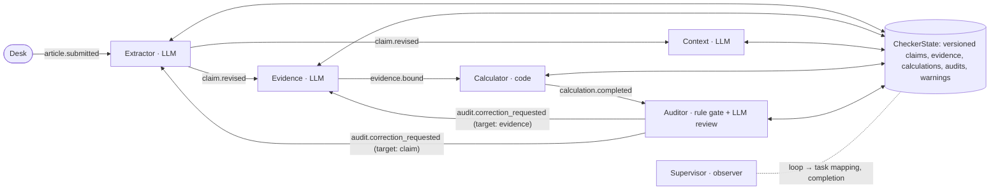

# Finance Claim Checker

**Concurrent Mozaik agents that check the earnings figures in a finance article (revenue, net income, gross profit, operating income and EPS) against the company's SEC 10-Q/10-K financial statements, and show a receipt for each verdict.**

> Not financial advice. This tool checks whether numbers in a text match a company's SEC financial statements. It does not evaluate the company or recommend any action.

Finance news and earnings coverage often get numbers wrong. Growth rates get transposed between table rows, "million" becomes "billion", a quarter's figure gets reported as the full year, adjusted profit gets presented as plain profit, or a percentage has no stated basis. Readers act on these numbers. This project reads an article, extracts its claims about six supported earnings metrics (revenue, net income, gross profit, operating income, diluted and basic EPS; anything else is reported as not verifiable), and checks them against the financial statements the company filed with the SEC: quarterly 10-Q statements (unaudited) and annual 10-K statements (audited). Every check comes with the filing, the line item, the dates, the input values and the formula.

**Live demo: https://finance-claim-checker.onrender.com** (no sign-in, no API key; runs the included example on replayed model responses).

```
npm install
npm run web        # verification workspace at http://localhost:4317 (no API key needed)
npm start          # same keyless demo in the terminal
```

## Web app (`npm run web`)

`npm run web` builds the frontend and starts a small local server at **http://localhost:4317**. The workspace opens on the included NVIDIA example, with a choice of model responses: the **genuine recorded Gemini run** (default, labelled *Synthetic example · Recorded gemini-3.5-flash-lite responses · Real calculations*) or the **hand-written fixtures** (a scripted run that shows the correction paths). From there you can:

1. **Run included example.** This starts the real agent workflow on the server, with no credentials. Claims, agent activity and reviews stream in as they happen over Server-Sent Events.
2. **Select a claim** from the results or from its highlight in the article. The evidence inspector shows:
   - the quote and how it was read
   - the current and comparison periods with dates, values, units and filing links
   - the formula with values substituted, and the tolerance rule
   - context warnings, the audit outcome, and the correction history
3. **View correction.** After a run, this opens each claim the auditor actually blocked (in the hand-written fixture run, c3's wrong comparison period and c4's profit figure wrongly labelled GAAP), with its real revision history.
4. **Download** the existing Markdown or JSON report for the run.
5. **Check your own article.** This uses live mode when a provider key is set on the server. Without one, the dialog explains how to configure it. Replay-only mode on edited text shows an explicit cache miss and offers to restore the example.

Each claim shows its numerical status and its review status separately. A claim counts as *Reviewed* only when the current calculation was approved by the auditor and the context review finished. Failed, pending or unresolved reviews are shown as such. Provenance (live, recorded, fixture or mixed) comes from the server's model-call records, and replay timings are labelled as replay timing, not live model latency.

Layout:
- **Wide screens:** article, results and inspector side by side.
- **Laptop widths:** the inspector opens as a right-hand drawer.
- **Phones:** Article / Results / Evidence tabs.

Keyboard navigation works throughout: highlights are focusable, the drawer and dialog trap focus, and Escape closes them. Reduced-motion settings are respected.

| Command | What it does |
|---|---|
| `npm run web` | Build the frontend and serve app + API on port 4317 (`PORT`/`HOST` env to change) |
| `npm run web:dev` | Vite dev server with hot reload, proxying `/api` to `npm run web:serve` |
| `npm run web:build` / `npm run web:serve` | Build only / serve only |

The server is a thin adapter (`src/web/`) around `runChecker()`. `viewmodel.ts` turns the engine's state, tasks and call records into display data, and the browser does no financial logic.

```
c3   ✘ MISMATCH            “Revenue more than doubled from a year earlier, rising 126%”
      actual +105.85% vs stated +126%  [Revenues/Q2-FY2027/26-000075, Revenues/Q2-FY2026/26-000075]
      context: MISLEADING_FRAMING
      audit: approved by auditor (LLM review)
c8   ✘ MISMATCH            “For the first half of fiscal 2027, revenue totaled $177.8 million”
      actual $177.837B vs stated $177.8 million  [Revenues/H1-FY2027/26-000075]
      note: Value matches if the scale were "billion" instead of "million" — likely a units error.
      audit: approved by auditor (LLM review)
c9   ✘ MISMATCH            “That compares with revenue of $57.0 billion for all of fiscal 2026”
      actual $215.938B vs stated $57.0 billion  [Revenues/FY-FY2026/26-000021]
      context: VALUE_MATCHES_OTHER_PERIOD
      audit: approved by auditor (LLM review)
c10  ⧗ NO 10-Q/10-K IN DATASET “Last week Nvidia said third-quarter revenue reached $115.8 billion”
      context: ATTRIBUTION, EARNINGS_RELEASE_ONLY
      audit: approved by auditor (rule)
```

`VALUE_MATCHES_OTHER_PERIOD` on c9 means the stated $57.0B is Q3 FY2026's *quarterly* revenue, not the full year. `EARNINGS_RELEASE_ONLY` on c10 means that in the SEC snapshot (fetched 2026-11-26) only the 8-K press release (filed 2026-11-17) covers that quarter; checking a release against itself would be circular, and a 10-Q filed after the snapshot would not be seen.

Full receipts are written to `out/report.md` (human-readable) and `out/report.json` (machine-readable).

---

## How it works

Seven participants share one Mozaik runtime. Four are model-driven agents, two are deterministic code, and one is an observer. Each agent task runs in its **own Mozaik loop with a fresh context**, so work on every claim proceeds in parallel. Participants coordinate only through semantic events and a shared, versioned `RuntimeState`. There is no fixed pipeline.



| Participant | Kind | Reacts to | Does |
|---|---|---|---|
| **Extractor** | LLM agent | `article.submitted`, claim corrections | Turns sentences into structured claims (`submit_claim`) and fixes a claim when the auditor asks (`revise_claim`). Code checks that each quote appears verbatim in the article and that the stated number appears in the quote. |
| **Evidence** | LLM agent | `claim.revised`, evidence corrections | Searches SEC facts and binds them **by id only** (`search_facts`, `bind_evidence`, `report_no_reference`). It never passes numbers. |
| **Context** | LLM agent | `claim.revised` | Flags framing problems such as cherry-picking, attribution and superlatives, kept separate from the numerical verdict. |
| **Calculator** | code | `evidence.bound` | Resolves values from evidence ids, computes, and attaches rule-based context warnings. |
| **Auditor** | code + LLM | `calculation.completed` | The rule gate blocks bad evidence and sends a correction request. The LLM review checks that the interpretation matches the sentence, then approves or requests a correction. |
| **Supervisor** | observer | every event | Maps Mozaik loops to tasks, finalises failed or silent tasks, and detects completion. |
| **Desk** | human participant | – | Submits the article. |

While one claim is blocked and being corrected, the others keep moving. In the fixture run, claims c3, c6, c8 and c9 are approved while c4 is being re-extracted.

## Design choices that make the numbers trustworthy

**1. The correct reference document.** Evidence comes only from **10-Q/10-K financial statements** (XBRL facts from SEC EDGAR; 10-Q statements are reviewed but unaudited, 10-K statements are audited). 8-K earnings releases are never used, because an earnings release is often the source of the article, so comparing the two would be circular. If no 10-Q/10-K in the SEC snapshot covers a period, the result is `REFERENCE_NOT_YET_FILED` (shown as "Reference unavailable in this dataset", with the snapshot date: a filing may exist after that date), and the release that *was* found is disclosed. Each receipt names the filing (form, accession number, filed date, link).

**2. Numbers and context are reported separately.** The *numerical result* (`MATCH`, `MISMATCH`, `NOT_COMPUTABLE`, `NOT_VERIFIABLE`, `REFERENCE_NOT_YET_FILED`) is shown separately from *context warnings*. The checker handles:
- **Quarterly vs annual vs year-to-date:** periods are identified from start/end dates and their position in the fiscal year, so a 6-month figure is never used for a quarter. Q4 is derived as FY − 9M and labelled as derived. Per-share Q4 values are not derived, because share counts differ between periods.
- **YoY vs QoQ:** comparison periods are computed deterministically (QoQ for Q1 → prior-year Q4). If the article doesn't state a basis, the check uses YoY and shows the QoQ figure as context.
- **GAAP vs adjusted:** non-GAAP figures are never compared with GAAP lines (`NOT_VERIFIABLE` plus a `NON_GAAP` warning). Profit claims that don't say which basis they use get `GAAP_OR_ADJUSTED_UNSTATED`.
- **Units:** dollar scale and per-share values are checked, and a million/billion slip gets an explicit hint.
- **Rounding:** the tolerance is half a unit in the article's last stated digit, so "$96.2 billion" allows ±$0.05B and "106%" allows ±0.5pp.
- **Zero or negative bases:** a percentage change from a zero or negative base is reported as `NOT_COMPUTABLE` along with the absolute change.
- **Restatements and stock splits:** the comparison value is taken *as presented in the same filing*, so it's split-adjusted. Material differences between filings are flagged as `RESTATED`.

**3. The auditor can correct, not just comment.** The rule gate checks source form, line item, period, duration, comparison base, same-filing comparatives and revision numbers. When a check fails, it **blocks** the result and sends a correction request to the agent that owns the faulty part: the evidence agent or the extractor. The fix triggers re-binding and **recalculation**. The LLM review can do the same for interpretation errors. Each claim has a budget of two corrections; after that it is marked `UNRESOLVED`.

**4. Claims and evidence are versioned.** Every claim has a revision (`r1`, `r2`…), and every evidence binding has an evidence revision (`e1`, `e2`…). Every derived result is stamped with the revisions it was computed from:
- Revising a claim invalidates that claim's evidence, calculation, audit and context warnings. Rebinding evidence invalidates its calculation and audit.
- Late writes stamped with an old revision are rejected and logged (`⟲ STALE`).
- Other claims are never touched. In the demo, a slow context review for c4 r1 arrives after r2 exists and is rejected.

**5. A complete evidence receipt.** Each result shows:
- the original quote and how it was interpreted
- the filing link and the XBRL line item
- the period label, start and end dates, units and every input value with its evidence id
- the formula with the numbers substituted in, the tolerance rule, the context warnings, and the claim's full revision history

The calculator **resolves values from validated evidence ids**. Agents can't pass amounts, and ids that don't exist are rejected.

**6. Mozaik is pinned and verified.** `@mozaik-ai/core` is pinned to exactly `6.0.0`, the package the hackathon rules name. `test/mozaik-compat.test.ts` runs without a key and proves the three runtime behaviours the design depends on:
- two agents' loops running at the same time
- tool calls writing shared `RuntimeState`
- a third participant reacting to a custom event

**7. Replay and validation you can trust.** Every model call is labelled by source:

| Mode | Model responses come from | Labelled |
|---|---|---|
| `--mode live` | the real provider | `live` |
| `--mode record` | the real provider, saved to `data/replay/recordings/` | `live` (saved as `recorded`) |
| `--mode replay` (default) | `--replay-source fixtures` (default), `recorded` (genuine recordings only, no fixture fallback) or `all` | `recorded` / `fixture` |
| `--mode author` | `fixtures/*.script.ts`, sealed to `data/replay/*.fixtures.json` | `fixture` |

- Two replay sources ship with the repo and are never mixed in one run:
  - **a genuine recording** (`data/replay/recordings/`): real `gemini-3.5-flash-lite` responses from a `--mode record` run; the web app uses it by default;
  - **hand-written fixtures** (`data/replay/*.fixtures.json`): a scripted run with two deliberate agent mistakes, to show the auditor's correction paths.
- Replay keys (cache policy version 2) hash everything the model sees: instructions, task message, earlier tool calls and their exact outputs, and every tool's name, description, parameter schema and strict flag. A different article, refreshed SEC data, a changed prompt or a changed tool schema produces an explicit **`CACHE_MISS`**; nothing is substituted. Cassettes record the key version, and replay refuses a cassette from another version.
- Recordings store each call's measured latency; replay waits recorded latency ÷ 10 so the live run's ordering is preserved. That timing is labelled as replay timing, never as model latency.
- In keyless mode, everything except the model text runs for real: SEC lookup, period identification, calculations, the rule gate, revision control and the receipts.
- Provider errors are isolated to their task. The claim is marked `FAILED`, or shown "unaudited" when only the review failed, and the run finishes.

## Running it

Requires Node `^20.19.0` or `>=22.12.0` (what Vite 7 and its React plugin need).

```bash
npm install
npm start                       # keyless replay of the hand-written demo fixtures
npm run check -- --replay-source recorded   # keyless replay of the genuine Gemini recording only
npm test                        # 110 tests, no key needed
npm run typecheck               # server + web
npm run eval                    # independent evaluation, replayed from eval/recordings (no key)
```

### Genuine model run (verified)

`npm run check -- --mode record --model gemini-3.5-flash-lite --rpm 10` ran the full workflow against Google's Gemini API:

- 76 requests (1 retried), 100,136 input + 3,239 output tokens;
- 10 of 10 claims extracted, every verdict correct, every claim audited;
- the units error ($177.8 *million*) stayed a mismatch, and the unstated basis on "18%" was flagged.

Replaying **only** that recording reproduced all 75 recorded calls with 0 cache misses and a field-by-field identical report: interpretations, verdicts, formulas, evidence inputs, context warnings and audits.

Earlier live runs found and fixed three real problems:
- Gemini 3 rejects tool calls whose thought signature is dropped: fixed with a signature-preserving mapper (`src/llm/gemini.ts`).
- The LLM auditor once "corrected" the article's $177.8 *million* to billion, turning a units error into a match. Now code rejects any interpretation whose number, unit, scale or comparison basis contradicts the quoted sentence (`checkAnchoring` in `src/agents/extractor.ts`).
- The extractor missed a claim about a quarter with no filing yet: the extractor's fiscal calendar now lists upcoming periods.

### Safety limits for live runs

Live and record runs stop cleanly, keeping partial results, when any of these limits is reached (`src/llm/limits.ts`; flags in brackets):

- a call cap of 150 requests (`--max-calls`)
- a turn cap of 12 per agent task and 40 for the article extractor (`--max-turns`)
- an optional USD budget computed from the token usage the provider reports (`--budget-usd`, prices built in for Claude, `--price in,out` for others)
- pacing: 4 requests in flight at most (`--max-concurrent`), optionally a requests-per-minute limit (`--rpm`)
- retries with backoff on 429/5xx/overload
- a per-request timeout (`--request-timeout`)

Every live run prints its measured token usage and cost.

**Check your own article** (needs a provider key in `.env`, see `.env.example`):

```bash
npm run check -- --article path/to/article.md --ticker NVDA --mode live
npm run check -- --article path/to/article.md --ticker NVDA --mode record   # also saves a replayable cassette
```

- Articles are Markdown: the first `# ` line is the title.
- The model is chosen from whichever key is set (`claude-sonnet-5-5`, `gpt-5.5` or `gemini-3.5-flash`). Override it with `--model` or `CHECKER_MODEL`.
- Other companies: `npm run snapshot:sec -- MSFT` saves a trimmed SEC snapshot, or pass `--live-sec`. Set `SEC_USER_AGENT="Your Name you@example.com"` first; SEC asks automated clients to identify themselves.
- Re-seal the demo fixtures after changing prompts or tools: `npm run fixtures:seal`.

## Tests

| File | Covers |
|---|---|
| `test/mozaik-compat.test.ts` | Pinned version; two concurrent agents, shared state, event reaction |
| `test/calculator.test.ts` | Rounding tolerance, units and scale errors, per-share, qualifiers, non-GAAP, YoY %, direction, zero and negative bases, multiples |
| `test/evidence.test.ts` | 10-Q/10-K only, quarter vs YTD, periods from dates (not tags), derived Q4, missing 10-Q + 8-K detection, restatements, SEC cache miss |
| `test/checks.test.ts` | Rule gate: YTD-for-quarter, QoQ-as-YoY, wrong line item, split-adjusted comparatives, no-reference verification, misread units; context rules |
| `test/store.test.ts` | Stale calculations, audits and context rejected; unaffected claims preserved; invalid evidence ids rejected; final audits immutable |
| `test/pipeline.test.ts` | Full keyless run: expected verdicts, ≥3 loops in flight, both correction paths, stale rejection, explicit cache miss, provider failures isolated |
| `test/web.test.ts` | Web adapter: canonical example article, visitors never block each other, replay/live load caps, SSE snapshots, UI values identical to the engine report, exact highlight offsets (overlapping/repeated quotes), real corrections, provenance, recording-only replay, measured trace, downloads, cache miss, live-without-key, failed audit/context never shown as reviewed |
| `test/extractor.test.ts` | Anchoring: complete numeric tokens (prefixes, decimals and precision, thousands separators, signs, repeated numbers), textual multiples, scale/unit/% must match the quote, comparison basis must be stated |
| `test/replay.test.ts` | Replay key covers tool descriptions/schemas/strict flag; order-insensitive; old responses miss after a schema change; incompatible cassette versions refused |
| `test/limits.test.ts` | Call/turn caps, USD budget from measured usage, retries and retry hints, pacing, request timeout, a capped run finishing cleanly |
| `test/gemini.test.ts` | Gemini thought signatures and call ids round-trip |
| `test/challenge.test.ts` | Reviewer recheck: accepted change → new revision, only that claim re-run; declined → earlier outcome restored; a recheck cannot launder a units error |

## Notes on Mozaik 6.0.0 (found while building)

- `runLoop` doesn't catch inference errors, so a provider failure becomes an unhandled rejection. Our runner catches it and ends the loop cleanly with the failure recorded on the task.
- Only the **first** function call of a model turn is executed. The agent instructions ask for one tool call per message.
- The Anthropic adapter sends `max_tokens` from `maxOutputTokens` with no default. We always set it.
- `InferenceInputValidator` isn't exported. To keep Mozaik's request validation in live mode, we get the default runner through `initializeRuntime(...).getInferenceRunner()`.
- `runLoop` appends to the `ModelContext` it receives. We give every task a fresh context; that keeps loops independent and makes the replay hashes deterministic.
- The Gemini adapter drops Gemini 3's `thoughtSignature` on function calls, so multi-turn tool use fails with a 400. `src/llm/gemini.ts` is the same mapping plus the signature, plugged into Mozaik's public `GeminiGenerateContent` endpoint.

## Independent evaluation

`eval/` holds two synthetic articles with claims the checker had never seen: other periods, a derived Q4, operating income and gross profit, a direction error, a "more than" qualifier, a units error, an unsupported margin, and a forecast. The expected outcomes in `eval/expected.json` were computed by hand from the SEC values, and cross-checked against NVIDIA's own release tables. `npm run eval -- --mode record` runs it live; `npm run eval` replays the recordings. Every rate below has its denominator.

**Run 1, first independent measurement** (`gemini-3.5-flash-lite`, before any change prompted by it; `eval/results-run1.md`):

| Measure | Result |
|---|---|
| Checkable claims extracted with the right metric, period and number | 14/15 |
| Verdict correct, among extracted | 14/14 |
| End-to-end correct | 14/15 |
| Abstentions on checkable claims | 0/14 |
| Unsupported claim (adjusted margin) handled correctly | 1/1 |
| Forecast correctly not extracted | 1/1 |
| Extracted but not fully reviewed | 1/14 (B8: the auditor's model request never returned) |
| Spurious extractions | 1 (A3 extracted with the wrong period: see below) |
| Runs failed / timed out | 1/2 (article B hit its run timeout because of that request) |

The run-1 results file was produced by an earlier scorer that also counted the correctly abstained margin claim as spurious; the table above corrects that by hand.

**Fixes made because of run 1:**
- "up 85% from $44.1 billion **a year earlier**" was labelled with the current quarter and approved by the LLM auditor. A rule now catches this case: if a figure is literally followed by "a year earlier/ago", is labelled with the current period, and exactly matches the prior-year period, it goes back to the extractor (`priorPeriodAttribution`). "$44.1 billion, up 85% from a year earlier" is deliberately left alone.
- Hung provider requests are now abandoned by an independent watchdog and recorded.
- Empty provider responses are retried instead of silently killing an agent loop.

**Run 2, after those fixes** (`eval/results-run2.md`; no longer independent for A3):
- **Article A:** 8/8 checkable claims correct and fully reviewed, A3 included; forecast skipped; 0 spurious.
- **Article B:** not run. Google's free-tier daily limit (500 requests/day for this model) was exhausted, and the runner stopped cleanly with that reason. Article B's figures therefore come from run 1 only.

## Measured concurrency

Every run exports `trace.json` (CLI `out/trace.json`, web "Trace" download): one lane per agent loop, opened and closed by Mozaik's own `message_received.started` / `model.answer` events, with task, claim and revision ids, and the computed peak number of loops active at once.

| Run | Peak loops at once | Loops | Timing |
|---|---|---|---|
| Live Gemini recording run | 9 | 28 | live wall-clock (4 provider requests in flight at most, 10/min pacing) |
| Hand-written fixture replay | 12 | 33 | simulated delays, not model latency |

"Active" means the loop was started and had not yet produced its final answer. A loop waiting on the model counts.

## Rechecking a claim

In the evidence inspector, "Challenge interpretation" sends a reviewer's concern to the extractor:
- If the extractor revises and the code validates the change (the anchoring rules above), a new claim revision is created, and only that claim's evidence, context and audit re-run. Other claims are untouched.
- If the extractor declines, the earlier outcome is restored and the decline is logged.

The button never sets a verdict; the calculator does. Rechecks call the model, so they need a provider key on the server. Recheck calls on a replayed run are labelled `live`, which makes the run's provenance visibly mixed. Verified with scripted model answers (accepted, declined, and an attempt to launder a units error, which the anchoring rule rejects). Against the real Gemini API, three attempts today hit provider limits (503 "high demand" on gemini-3.5-flash and gemini-3.8-flash; 429 quota on gemini-3.1-pro-preview). Each time the failure was labelled, the earlier approval was restored and no other claim changed, but a real-model recheck that completes has not been observed yet.

## Public deployment and load

The server has no global lock:
- Each visitor's example run is independent. Up to 8 replay runs run at once, each with a 2-minute timeout; above that a visitor gets "busy, retry".
- Live runs and rechecks run one at a time, with a 5-minute timeout plus the per-run call and turn caps.

On a host, bind `HOST=0.0.0.0` and the platform's `PORT`. Never set a provider key on a public deployment: without one, live mode and rechecks are disabled and explain why.

### Deploy

The repo ships a `Dockerfile`. It installs the dependencies (dev dependencies included, since `tsx` and `vite` are needed), builds the frontend, and runs the server on `0.0.0.0:$PORT` as a non-root user. `.dockerignore` keeps `.env` out of the image.

```bash
docker build -t finance-claim-checker .
docker run --rm -p 8080:8080 finance-claim-checker    # http://localhost:8080
```

**Live instance:** https://finance-claim-checker.onrender.com runs this Dockerfile on Render (Singapore, 0.5 CPU / 512 MB, `HOST=0.0.0.0`, health check `/api/meta`, no provider key). Checked against the public URL on 26 Nov 2026:
- the page and bundle load;
- `/api/meta` reports live mode as not configured;
- two example runs started at the same time (recorded and fixtures) both finished with 10/10 claims reviewed (4 match, 4 mismatch, 1 not verifiable, 1 reference unavailable), streamed over SSE and labelled their sources (75 recorded calls; 86 fixture calls);
- traces show peaks of 9 and 12 agent loops at once;
- `report.md`, `report.json` and `trace.json` download as attachments;
- a live custom run and a recheck are both refused with `LIVE_NOT_CONFIGURED`;
- new text in replay mode ends as an explicit `cache_miss`.

**Render (free plan):** Dashboard → **New → Blueprint** → select this repository. `render.yaml` creates a free Docker web service with `/api/meta` as the health check, and the URL is `https://<service-name>.onrender.com`. Free instances sleep after about 15 idle minutes, so the first request after that takes up to a minute. Any host that runs a long-lived container with Server-Sent Events works (Render, Railway, Fly.io); serverless-only platforms don't.

Verified locally without Docker, by reproducing the image's build context (no `.env`) and start command (`HOST=0.0.0.0 PORT=… node --import tsx src/web/server.ts`):
- two simultaneous visitors, one replaying the recording and one the fixtures, both reached 10 of 10 reviewed claims over SSE;
- Markdown, JSON and trace downloads returned attachments;
- live checks and rechecks answered `LIVE_NOT_CONFIGURED`.

A real `docker build` has not been run here.

## Limitations

- Live runs have been verified with one provider and model (`gemini-3.5-flash-lite`). Claude and OpenAI paths go through Mozaik's adapters and our safety limits but have not been run against the real APIs here.
- The checker covers six statement line items (revenue, net income, gross profit, operating income, diluted and basic EPS) for one company per article, and only US SEC filers. Ratios such as margins are not representable and are reported as not verifiable or skipped. The bundled SEC data covers NVIDIA only; custom articles are checked against NVIDIA.
- Fiscal periods in the article are mapped by the extractor model, using the fiscal calendar it is given. The auditor's LLM review is the check on that mapping.
- Tolerance choices are deliberate policies: rounding of stated digits, "about" = 1%, multiples ±5%.
- Non-GAAP figures can't be verified against financial statements by design.

## Project layout

```
src/sec/        EDGAR snapshot/fetch, fiscal-period identification, evidence registry
src/domain/     claim types, deterministic calculator, rule gate + context rules, versioned state
src/agents/     Extractor, Evidence, Context, Calculator, Auditor participants
src/runtime/    Mozaik wiring, task tracking, pipeline/supervisor
src/llm/        provenance-labelled runner (live / record / replay / author)
src/report/     live terminal view, Markdown and JSON receipts
src/web/        web server (SSE + downloads) and view model
web/            React workspace (Vite)
data/           SEC snapshot (NVDA), demo article, sealed fixtures, recordings
fixtures/       hand-written demo script (source of the sealed fixtures)
```

**Data:** the SEC EDGAR XBRL company facts and filing index are public data, and the snapshot records its source URLs and fetch time. The demo article is synthetic and labelled as such. Its correct figures come from NVIDIA's public filings, and its errors are deliberate.
