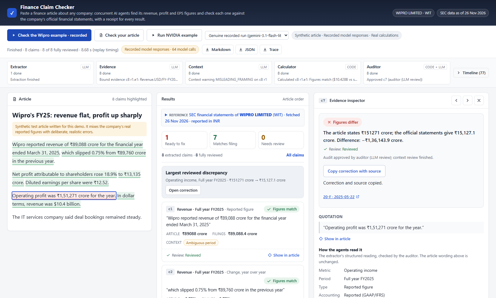
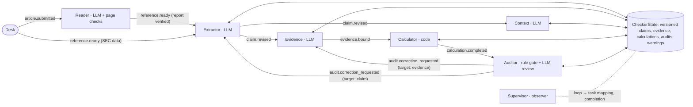

# Finance Claim Checker

Finance Claim Checker helps a financial editor decide which figures in an earnings draft need a correction before publication. It compares quoted figures with the company's SEC filing or supplied results PDF, shows the calculation and lets the editor copy a sourced correction.

[Open the keyless Wipro demo on Render](https://finance-claim-checker.onrender.com/) · [Read the live benchmark](eval/editor-deadline.md) · [See an Auditor intervention](#inspect-an-auditor-revision)

```sh
npm ci
npm run web
```

## Try the Wipro case

1. From a fresh checkout with Node.js 22.13 or later, run `npm ci` and `npm run web`. Open [the local app](http://localhost:4317).
2. Select **Check the Wipro example · recorded**. The example uses a synthetic draft, an included SEC snapshot and genuine recorded model responses. It runs without an API key or external data fetch after installation.
3. In **Results**, open the largest discrepancy or choose **Ready to fix** and select **Operating income**. The draft put ₹1,51,271 crore in print. Wipro reported ₹151,271 million, equivalent to **₹15,127.1 crore**. Select **Copy correction with source** to get the corrected sentence and filing. [Wipro FY2025 Form 20-F](https://www.sec.gov/Archives/edgar/data/1123799/000095017025076303/wit-20250331.htm)
4. **Ready to fix** updates as individual claims finish review. Open **Timeline** to see the agents work on different claims while the extractor is still reading. The calculator binds each result to a version of its inputs. A claim revision invalidates the old calculation and audit.



### Inspect an Auditor revision

Select **See scripted auditor correction** in **Results**. The NVIDIA fixture opens **Timeline** and shows work on other claims continuing while the Auditor's objection sends a claim back for review. For claim `c3`, the Evidence agent replaces a prior-quarter comparison with the prior-year quarter, and the Auditor approves the resulting year-over-year correction. For claim `c4`, the Extractor revises the interpretation and the app discards stale results from the previous revision. The fixture uses scripted responses and runs without a key. [Fixture trace](eval/editor-auditor-fixture.json)

### What concurrency changed

On six fresh drafts across four issuers, the concurrent scheduler produced **5 of 5** correct, fully reviewed edits within the 60-second benchmark cutoff. The serial scheduler produced **4 of 5**. Both had zero false corrections and two unfinished reviews. On the two-edit Apple draft, the second correct edit was ready at **41.11 s concurrent** and **92.08 s serial**. The report includes every arm, provider failures, filing snapshots, and the follow-up on the historical EPS review. [Live results and reproduction commands](eval/editor-deadline.md)

Three paired runs used the same Wipro draft, filing, captured model responses and checks. One scheduler allowed overlap. The other completed one agent loop at a time. The order alternated between pairs. The replay divided the originally recorded response latencies by 100 in both arms. Timing starts when the checker receives the article. The first discrepancy requires the correct INR operating income from the specified accession.

| Median over three runs per scheduler | Concurrent | Serial |
|---|---:|---:|
| First source-backed operating profit discrepancy | 2.88 s | 18.49 s |
| All eight claims reviewed | 4.03 s | 30.03 s |
| Peak active agent loops | 12 | 1 |
| Correct verdicts per run | 8/8 | 8/8 |
| Recorded model calls per run | 64 | 64 |

Run `npm run benchmark` to reproduce the comparison. It writes a trace for each run and a summary under `out/benchmark-replay/`. These measurements describe the scheduling difference in replay. For current model latency, run `npm run benchmark -- --live --pairs 1` with a configured provider. [Six measured runs](eval/benchmark-wipro-replay.json)

The live benchmark uses the same pinned SEC snapshot, article, model and provider limits in both arms. Set `CHECKER_MODEL` to select the model. Run `npm run benchmark -- --live --pairs 1 --case apple` for a separate two-claim Apple draft. Both cases record when the first correct correction became available to copy, whether it was ready within 60 seconds, and whether any incorrect correction was offered. Each arm writes claim receipts and a Mozaik trace. The summary includes the input hash and timing for both arms.

In one live Apple pair on Gemini 3.1 Flash-Lite, the correction was ready in **50.92 s concurrent** and **130.72 s serial**. Both arms returned two correct, fully reviewed verdicts with zero incorrect corrections. The serial run went first and logged a provider error after the auditor approved the correction. This pair shows what happened in those runs. Repeated, order-alternated runs are needed for a general latency estimate. [Live Apple results](eval/benchmark-apple-live.json)

In one live Wipro pair on the same model, the correction was ready in **113.14 s concurrent** and **268.93 s serial**. Both arms got eight numerical verdicts right. Gemini overload and rate limiting left two reviews incomplete in the concurrent arm. The serial arm completed all eight reviews. [Live Wipro results](eval/benchmark-wipro-live.json)

> Not financial advice. This tool checks whether numbers in a text match a company's official financial statements. It does not evaluate the company or recommend any action.

Finance news and earnings coverage often get numbers wrong:
- growth rates get transposed between table rows
- "million" becomes "billion", or "million" becomes "crore"
- a quarter's figure gets reported as the full year
- adjusted profit gets presented as plain profit, a standalone figure as consolidated, or a percentage has no stated basis

Readers act on these numbers. This project reads an article and **identifies the company**: from the text, or from what you type, against SEC's full list of about 8,000 filers, with no fixed company list. When the text could mean several companies, you choose.

It then extracts the claims about six supported metrics (revenue, net income, gross profit, operating income, diluted and basic EPS), and checks each against that company's statements:
- **SEC filers:** quarterly 10-Q (unaudited), annual 10-K (audited), and 20-F/40-F annual reports for foreign issuers, in US GAAP or IFRS and in the filing's own currency.
- **Companies without usable SEC data:** supply the issuer's results PDF. The checker requires an issuer match before using statement pages and verifies each accepted number against its page. A matching issuer heading establishes consistency with the selected company. Uploaded files still need independent provenance verification.

Every check comes with the document, the line item (or page, row and column), the dates, the input values and the formula. Missing or unverifiable data is reported as such. No other company's data is ever substituted, and no value is invented.

[Hosted app](https://finance-claim-checker.onrender.com/). The available modes appear in the app. Custom text uses a configured provider. The included recordings preserve the original model prompts for their exact articles, and the current code checks the resulting figures and flags disputed warnings.

```
npm ci
npm run web        # verification workspace at http://localhost:4317 ("Check your article" is the start screen)
npm start          # keyless NVIDIA example in the terminal
npm run check -- --article my-article.md --mode live        # any company (needs a provider key in .env)
```

## What works, exactly

Verified on 27 Nov 2026 with a real model (`gemini-3.1-flash-lite`) on fresh articles about four companies besides NVIDIA, plus an unknown company and unavailable-report cases. Results are under [Multi-company verification](#multi-company-verification).

| Source format | Status | What was verified |
|---|---|---|
| SEC XBRL, **10-Q / 10-K**, US GAAP, USD | ✅ works | NVIDIA (January fiscal year), Apple (September fiscal year, derived Q4), Walmart (January fiscal year, first-half totals, "total revenues" vs "net sales") |
| SEC XBRL, **20-F**, IFRS, **INR** | ✅ works | Wipro: ₹ crore claims checked against INR statements, a USD convenience translation flagged, a crore-vs-million units error caught |
| SEC XBRL, **20-F**, IFRS, **USD only** | ✅ works | Infosys: dollar claims checked; rupee claims reported as *not comparable* (no exchange rate is applied) |
| SEC XBRL, **40-F** | ⚠ supported in code, not run | same path as 20-F |
| SEC XBRL, bank income statements | ✅ unit-tested | JPMorgan's `RevenuesNetOfInterestExpense` is used as revenue |
| **Official report PDF** with a text layer (results tables) | ✅ figures read and verified on a **real company PDF** | TCS's Ind AS consolidated interim statements for Q2 FY27 (58 pages): two live Reader runs each ended with **20/20 figures verified** on the profit and loss page (revenue, both profit lines, EPS, four columns), values exact. Also generated test PDFs: quarter/half/year columns, same-date columns, "(Rs. in crore)", consolidated vs standalone. The full claim check of the TCS article is **pending**: Gemini's free daily quota ran out mid-run (details under [A real company report](#a-real-company-report-tcs)) |
| Scanned PDFs (no text layer) | ❌ not supported | reported as `REPORT_NO_TEXT`; no OCR |
| HTML report pages, XLSX, iXBRL documents | ❌ not supported | an HTML URL is reported as `REPORT_NOT_PDF` |
| Earnings releases (8-K, 6-K) | ❌ deliberately excluded | they are often the article's source, so using them would be circular |
| 6-K quarterly results of foreign issuers | ❌ not available | SEC XBRL has only their annual 20-F/40-F figures; give the report PDF instead |

| Metric | SEC concepts (priority order) | From a report PDF |
|---|---|---|
| Revenue | `Revenues`, `RevenueFromContractWithCustomer…`, `SalesRevenueNet`, `RevenuesNetOfInterestExpense`, IFRS `Revenue`, `RevenueFromContractsWithCustomers` | "Revenue from operations", "Total revenue", "Net sales" (never "Total income") |
| Net income | `NetIncomeLoss`, IFRS `ProfitLossAttributableToOwnersOfParent`, then `ProfitLoss` (incl. non-controlling interests) | profit attributable to shareholders (also an indented "Shareholders of the Company" row read with its "attributable to:" heading), then "Profit for the period"; kept as two separate line items |
| Gross profit | `GrossProfit` (US GAAP, IFRS) | rows labelled gross profit |
| Operating income | `OperatingIncomeLoss`, IFRS `ProfitLossFromOperatingActivities` | rows labelled operating profit / income from operations |
| Diluted / basic EPS | `EarningsPerShareDiluted/Basic`, IFRS `Diluted/BasicEarningsLossPerShare` | "(b) Diluted" / "(a) Basic" rows |

Anything else (margins, segment revenue, EBITDA, "total income", guidance) is reported as not verifiable or skipped.

**Validated by code, not by the model:**
- **Currency:** read from the symbol or word next to the number (`$`, `US$`, `₹`, `Rs.`, `INR`, `€`, `£`, `¥`, "rupees", "euros"…). Amounts are compared only in the same currency.
- **Scale:** thousand, **lakh**, million, **crore**, billion, trillion and **lakh crore**, as written. A slip such as crore for million gets an explicit units hint.
- **Indian digit grouping:** `1,51,271` is read as 151271.
- **Consolidated vs standalone:** from the sentence; an unstated basis uses the consolidated figure and shows the standalone one as context.
- **Fiscal periods:** from filing dates, for any year-end.
- **Reported vs adjusted:** adjusted figures are never compared with statement lines.
- **Line items:** the primary one is used unless the article names a narrower one ("net sales").

## Web app (`npm run web`)

`npm run web` builds the frontend and starts a small local server at **http://localhost:4317**. The start screen is **Check a finance article**:

1. **Paste an article** (or pick a fresh sample: Apple, Walmart, Wipro in ₹ crore, Infosys in ₹ vs $, an unknown company). As you type, the server identifies the company without calling a model:
   - **Resolved:** shows the company (SEC name, ticker, CIK, why it was chosen) and a preview of its reference: forms, latest period, reporting currency, fetch date.
   - **Ambiguous:** asks you to choose between the candidates.
   - **No SEC filer, or no usable SEC data:** asks for the company's **official report PDF** (a URL, or an upload of up to 25 MB).
2. **Check article.** The server prepares the reference, then the agents run. Claims, agent activity and reviews stream in over Server-Sent Events, and a reference panel says exactly what the run was checked against:
   - for SEC data: the company facts and filing links;
   - for a report: each verified figure with its page, row, column, printed value and unit note, plus every proposal the code rejected and why.
3. **Or run the included NVIDIA example**, with a choice of model responses: the **genuine recorded Gemini run** (default) or the **hand-written fixtures**, a scripted run that shows the correction paths.

After a run:

1. **Select a claim** from the results or from its highlight in the article. The evidence inspector shows:
   - the quote and how it was read
   - the current and comparison periods with dates, values, units and filing links
   - the formula with values substituted, and the tolerance rule
   - context warnings, the audit outcome, and the correction history
2. **View correction.** This opens each claim the auditor actually blocked (in the hand-written fixture run, c3's wrong comparison period and c4's profit figure wrongly labelled GAAP), with its real revision history.
3. **Download** the Markdown, JSON or trace report for the run.

New text needs live mode: a provider key on the server. Without one, the form explains how to configure it. In replay-only mode, text without a recording stops with an explicit cache miss.

Each claim shows its numerical status and its review status separately. A claim counts as *Reviewed* only when the current calculation was approved by the auditor and the context review finished. Failed, pending or unresolved reviews are shown as such. Provenance (live, recorded, fixture or mixed) comes from the server's model-call records, and replay timings are labelled as replay timing, not live model latency.

Layout:
- **Wide screens:** article, results and inspector side by side.
- **Laptop widths:** the inspector opens as a right-hand drawer.
- **Phones:** Article / Results / Evidence tabs.

Keyboard navigation works throughout: highlights are focusable, the drawer and dialog trap focus, and Escape closes them. Reduced-motion settings are respected.

| Command | What it does |
|---|---|
| `npm run web` | Build the frontend and serve app + API on port 4317 (`PORT`/`HOST` env to change) |
| `npm run web:dev` | Vite dev server with hot reload, proxying `/api` to `npm run web:serve` |
| `npm run web:build` / `npm run web:serve` | Build only / serve only |

The server is a thin adapter (`src/web/`) around `runChecker()`. `viewmodel.ts` turns the engine's state, tasks and call records into display data, and the browser does no financial logic.

```
c3   ✘ MISMATCH            “Revenue more than doubled from a year earlier, rising 126%”
      actual +105.85% vs stated +126%  [Revenues/Q2-FY2027/26-000075, Revenues/Q2-FY2026/26-000075]
      context: MISLEADING_FRAMING
      audit: approved by auditor (LLM review)
c8   ✘ MISMATCH            “For the first half of fiscal 2027, revenue totaled $177.8 million”
      actual $177.837B vs stated $177.8 million  [Revenues/H1-FY2027/26-000075]
      note: Value matches if the scale were "billion" instead of "million" — likely a units error.
      audit: approved by auditor (LLM review)
c9   ✘ MISMATCH            “That compares with revenue of $57.0 billion for all of fiscal 2026”
      actual $215.938B vs stated $57.0 billion  [Revenues/FY-FY2026/26-000021]
      context: VALUE_MATCHES_OTHER_PERIOD
      audit: approved by auditor (LLM review)
c10  ⧗ NO 10-Q/10-K IN DATASET “Last week Nvidia said third-quarter revenue reached $115.8 billion”
      context: ATTRIBUTION, EARNINGS_RELEASE_ONLY
      audit: approved by auditor (rule)
```

`VALUE_MATCHES_OTHER_PERIOD` on c9 means the stated $57.0B is Q3 FY2026's *quarterly* revenue, not the full year. `EARNINGS_RELEASE_ONLY` on c10 means that in the SEC snapshot (fetched 2026-11-26) only the 8-K press release (filed 2026-11-17) covers that quarter; checking a release against itself would be circular, and a 10-Q filed after the snapshot would not be seen.

Full receipts are written to `out/report.md` (human-readable) and `out/report.json` (machine-readable).

---

## How it works

**Before any agent runs, the reference is prepared deterministically** (`src/runtime/reference.ts`, no model call):
1. **Company.** Taken from an explicit CIK, ticker or name, or detected in the article: exchange tickers ("NYSE: WMT"), then company names (whole words, capitalized, headline and lead weighted) matched against SEC's `company_tickers.json`. Ambiguous text returns the candidates for the user to choose (`409 COMPANY_AMBIGUOUS`). An unknown company returns `404 COMPANY_NOT_FOUND` and asks for a report.
2. **Reference.**
   - **Report given:** the official report PDF. It must be a public http(s) URL (no private or local addresses, redirects re-checked, 25 MB cap) or an upload. The text and positions of every page are extracted with pdfjs.
   - **Otherwise:** the company's SEC company facts and filing index, fetched live and cached for 6 hours. Replays use the committed snapshot in `data/sec-snapshot/` when there is one, so recorded runs stay reproducible.
   - **No usable XBRL data:** `422 SEC_DATA_UNAVAILABLE`, which asks for a report.

Then eight participants share one Mozaik runtime. Five are model-driven agents, two are deterministic code, and one is an observer. Each agent task runs in its **own Mozaik loop with a fresh context**, so work on every claim proceeds in parallel. Participants coordinate only through semantic events and a shared, versioned `RuntimeState`. There is no fixed pipeline.



| Participant | Kind | Reacts to | Does |
|---|---|---|---|
| **Reader** | LLM agent + code | `article.submitted` (report runs only) | Reads the statement pages that code selected (pages with revenue, profit and EPS rows, a unit note and column dates) and proposes facts with `record_facts`: metric, page, row label, column, value as printed. Code verifies each one on the page (`src/docs/verify.ts`) before it becomes evidence. The run continues only if at least one figure was verified. |
| **Extractor** | LLM agent | `reference.ready`, claim corrections | Turns sentences into structured claims (`submit_claim`) and fixes a claim when the auditor asks (`revise_claim`). Code checks that each quote appears verbatim in the article, that the stated number, scale and basis match the quote, and reads the currency and consolidated/standalone basis from the text itself. |
| **Evidence** | code + LLM agent | `claim.revised`, evidence corrections | Binds statement facts (SEC XBRL or verified report facts) **by id only**; it never passes numbers. **Clear cases are bound by code with no model call** (`src/domain/evidence-plan.ts`): a level claim with exactly one figure for its metric, period, currency and consolidation, consistent across filings; or a period no statement covers. Change claims, conflicting or restated figures, a line item the article names, or a missing standalone figure go to the LLM agent. Its first prompt lists the candidate facts for the claim's period and comparison periods, so it can `bind_evidence` on its first turn; `search_facts` and `report_no_reference` stay available. |
| **Context** | LLM agent | `claim.revised` | Flags framing problems such as cherry-picking, attribution and superlatives, kept separate from the numerical verdict. |
| **Calculator** | code | `evidence.bound` | Resolves values from evidence ids, computes, and attaches rule-based context warnings. |
| **Auditor** | code + LLM | `calculation.completed` | The rule gate blocks bad evidence and sends a correction request. The LLM review checks that the interpretation matches the sentence, then approves or requests a correction. |
| **Supervisor** | observer | every event | Maps Mozaik loops to tasks, finalises failed or silent tasks, and detects completion. |
| **Desk** | human participant | – | Submits the article. |

While one claim is blocked and being corrected, the others keep moving. In the fixture run, claims c3, c6, c8 and c9 are approved while c4 is being re-extracted.

## Design choices that make the numbers trustworthy

**1. The correct reference document.** Evidence comes only from **financial statements**:
- **SEC filers:** XBRL facts from SEC EDGAR. 10-Q statements are reviewed but unaudited; 10-K, 20-F and 40-F statements are audited.
- **Other companies:** the official report the user provides, read figure by figure and verified on its page.

Earnings releases (8-K, 6-K) are never used: a release is often the source of the article, so comparing the two would be circular.

If the reference doesn't cover a period, the result is `REFERENCE_NOT_YET_FILED`, shown as "No statement for this period in the reference" with the fetch date (a filing may exist after that date). Any release that *was* found is disclosed. Each receipt names the filing (form, accession number, filed date, link) or the report page, row and column.

**Report verification.** A figure from a PDF is accepted only if code finds all of the following on the page:
- the row label, and the printed value on that row;
- the value sitting under a column header carrying the stated period-end date;
- a column label identifying the stated quarter, half-year, nine months or year. Columns sharing an end date need distinct heading geometry. Ambiguous headers cause the checker to decline the proposed figure.
- a unit note such as "(Rs. in crore)", "(₹ in lakhs)" or "(In millions)", which sets the scale and currency (never the model);
- a statement heading that says consolidated or standalone.

The value used is the printed number × the note's scale, computed exactly in decimal. Rejected proposals are listed with their reasons in the report.

**2. Numbers and context are reported separately.** The *numerical result* (`MATCH`, `MISMATCH`, `NOT_COMPUTABLE`, `NOT_VERIFIABLE`, `REFERENCE_NOT_YET_FILED`) is shown separately from *context warnings*. The checker handles:
- **Quarterly vs annual vs year-to-date:** periods are identified from start/end dates and their position in the fiscal year, so a 6-month figure is never used for a quarter. Q4 is derived as FY − 9M and labelled as derived. Per-share Q4 values are not derived, because share counts differ between periods.
- **YoY vs QoQ:** comparison periods are computed deterministically (QoQ for Q1 → prior-year Q4). If the article doesn't state a basis, the check uses YoY and shows the QoQ figure as context.
- **GAAP vs adjusted:** non-GAAP figures are never compared with GAAP lines (`NOT_VERIFIABLE` plus a `NON_GAAP` warning). Profit claims that don't say which basis they use get `GAAP_OR_ADJUSTED_UNSTATED`.
- **Units and currency:** scale (thousand, lakh, million, crore, billion, trillion, lakh crore) and per-share values are checked, and a scale slip (million/billion, crore/million) gets an explicit hint. Amounts are compared only in the same currency.
  - A rupee claim against a dollar-only filing is `NOT_COMPUTABLE`; no exchange rate is ever applied.
  - A 20-F convenience translation (e.g. Wipro's USD columns) is used only when the article states that currency, and it is flagged.
- **Consolidated vs standalone:** a standalone claim needs a standalone figure. Otherwise the consolidated figure is used, and the other one is shown when it differs.
- **Primary line item:** e.g. `NetIncomeLoss` before `ProfitLoss`, and total revenues before net sales, unless the article names the narrower line.
- **Rounding:** the tolerance is half a unit in the article's last stated digit, so "$96.2 billion" allows ±$0.05B and "106%" allows ±0.5pp.
- **Zero or negative bases:** a percentage change from a zero or negative base is reported as `NOT_COMPUTABLE` along with the absolute change.
- **Restatements and stock splits:** the comparison value is taken *as presented in the same filing*, so it's split-adjusted. Material differences between filings are flagged as `RESTATED`.

**3. The auditor can correct, not just comment.** The rule gate checks source form, line item, period, duration, comparison base, same-filing comparatives and revision numbers. When a check fails, it **blocks** the result and sends a correction request to the agent that owns the faulty part: the evidence agent or the extractor. The fix triggers re-binding and **recalculation**. The LLM review can do the same for interpretation errors. Each claim has a budget of two corrections; after that it is marked `UNRESOLVED`.

A binding made by code goes through exactly the same calculator, rule gate, LLM review and correction flow as an agent's binding. An evidence correction on it is handled by the Evidence agent (`test/evidence-fastpath.test.ts`).

Before binding, code checks for restatements and conflicting figures. If the same line item and period appears with different values, for example Wipro's FY2024 diluted EPS (₹20.82 as first reported, ₹10.41 restated after a bonus issue), the claim goes to the agent with both figures listed, and the receipt carries a `RESTATED` warning.

In the hand-written demo this cuts model calls from 86 to 68.

**4. Claims and evidence are versioned.** Every claim has a revision (`r1`, `r2`…), and every evidence binding has an evidence revision (`e1`, `e2`…). Every derived result is stamped with the revisions it was computed from:
- Revising a claim invalidates that claim's evidence, calculation, audit and context warnings. Rebinding evidence invalidates its calculation and audit.
- Late writes stamped with an old revision are rejected and logged (`⟲ STALE`).
- Other claims are never touched. In the demo, a slow context review for c4 r1 arrives after r2 exists and is rejected.

**5. A complete evidence receipt.** Each result shows:
- the original quote and how it was interpreted
- the filing link and the XBRL line item
- the period label, start and end dates, units and every input value with its evidence id
- the formula with the numbers substituted in, the tolerance rule, the context warnings, and the claim's full revision history

The calculator **resolves values from validated evidence ids**. Agents can't pass amounts, and ids that don't exist are rejected.

**6. Mozaik is pinned and verified.** `@mozaik-ai/core` is pinned to exactly `6.0.0`, the package the hackathon rules name. `test/mozaik-compat.test.ts` runs without a key and proves the three runtime behaviours the design depends on:
- two agents' loops running at the same time
- tool calls writing shared `RuntimeState`
- a third participant reacting to a custom event

**7. Replay and validation you can trust.** Every model call is labelled by source:

| Mode | Model responses come from | Labelled |
|---|---|---|
| `--mode live` | the real provider | `live` |
| `--mode record` | the real provider, saved to `data/replay/recordings/` | `live` (saved as `recorded`) |
| `--mode replay` (default) | `--replay-source fixtures` (default), `recorded` (genuine recordings only, no fixture fallback) or `all` | `recorded` / `fixture` |
| `--mode author` | `fixtures/*.script.ts`, sealed to `data/replay/*.fixtures.json` | `fixture` |

- Two replay sources ship with the repo and are never mixed in one run:
  - **genuine recordings** (`data/replay/recordings/`): real `gemini-3.1-flash-lite` responses from `--mode record` runs, one per article (the NVIDIA example and the sample articles); the web app uses them by default;
  - **hand-written fixtures** (`data/replay/*.fixtures.json`): a scripted run with two deliberate agent mistakes, to show the auditor's correction paths.
- Replay keys (cache policy version 2) hash everything the model sees: instructions, task message, earlier tool calls and their exact outputs, and every tool's name, description, parameter schema and strict flag. A different article, refreshed SEC data, a changed prompt or a changed tool schema produces an explicit **`CACHE_MISS`**; nothing is substituted. Cassettes record the key version, and replay refuses a cassette from another version.
- Recordings store each call's measured latency; standard replay waits recorded latency ÷ 10. The featured Wipro example uses ÷ 100. That timing is labelled as replay timing, never as model latency.
- In keyless mode, everything except the model text runs for real: SEC lookup, period identification, calculations, the rule gate, revision control and the receipts.
- Provider errors are isolated to their task. The claim is marked `FAILED`, or shown "unaudited" when only the review failed, and the run finishes.

## Running it

Requires Node `>=22.13.0` (pdfjs-dist 6 for reading report PDFs; Vite 7 needs `>=22.12`).

```bash
npm install
npm start                       # keyless replay of the hand-written demo fixtures
npm run check -- --replay-source recorded   # keyless replay of the genuine Gemini recording only
npm test                        # 126 tests, no key needed
npm run typecheck               # server + web
npm run eval                    # multi-company evaluation, replayed from the genuine recordings (no key)
```

### Genuine model run (verified)

`npm run check -- --mode record --model gemini-3.1-flash-lite --rpm 12` ran the full multi-company workflow on the NVIDIA example against Google's Gemini API (27 Nov 2026):

- 84 requests (6 retried after 503 "high demand" or a 120-second timeout), 102,147 input + 3,156 output tokens;
- 10 of 10 claims extracted, every verdict correct, every claim audited;
- peak of 7 agent loops at once;
- the units error ($177.8 *million*) stayed a mismatch, and the unstated basis on "18%" was flagged.

Replaying **only** that recording reproduces all 78 recorded calls with 0 cache misses (`npm run check -- --replay-source recorded`). The first genuine run (gemini-3.5-flash-lite, 26 Nov, single-company prompts) is kept in `data/replay/superseded/`.

Earlier live runs found and fixed three real problems:
- Gemini 3 rejects tool calls whose thought signature is dropped: fixed with a signature-preserving mapper (`src/llm/gemini.ts`).
- The LLM auditor once "corrected" the article's $177.8 *million* to billion, turning a units error into a match. Now code rejects any interpretation whose number, unit, scale or comparison basis contradicts the quoted sentence (`checkAnchoring` in `src/agents/extractor.ts`).
- The extractor missed a claim about a quarter with no filing yet: the extractor's fiscal calendar now lists upcoming periods.

### Safety limits for live runs

Live and record runs stop cleanly, keeping partial results, when any of these limits is reached (`src/llm/limits.ts`; flags in brackets):

- a call cap of 150 requests (`--max-calls`)
- a turn cap of 12 per agent task and 40 for the article extractor (`--max-turns`)
- an optional USD budget computed from the token usage the provider reports (`--budget-usd`, prices built in for Claude, `--price in,out` for others)
- pacing: 4 requests in flight at most (`--max-concurrent`), optionally a requests-per-minute limit (`--rpm`)
- retries with backoff on 429/5xx/overload
- a per-request timeout (`--request-timeout`)

Every live run prints its measured token usage and cost.

**Check your own article, about any company** (needs a provider key in `.env`, see `.env.example`):

```bash
npm run check -- --article my-article.md --mode live                          # company detected from the article
npm run check -- --article my-article.md --company "Walmart" --mode live      # or named (ticker or name)
npm run check -- --article my-article.md --company "Tata Consultancy Services" --report https://…/results.pdf --mode live
npm run check -- --article my-article.md --company "TestCo" --report-file results.pdf --mode live
npm run check -- --article my-article.md --mode record                        # also saves a replayable cassette
```

- Articles are Markdown: the first `# ` line is the title.
- An ambiguous company stops with the candidate list (pass `--company` to choose). An unknown company, or one without usable SEC data, stops and asks for `--report`.
- SEC data: the committed snapshot in `data/sec-snapshot/` if there is one, else fetched live from EDGAR. `--live-sec` always fetches. `npm run snapshot:sec -- MSFT` saves a snapshot, and `npm run snapshot:companies` refreshes SEC's company list. Set `SEC_USER_AGENT="Your Name you@example.com"` first; SEC asks automated clients to identify themselves.
- `--ticker NVDA` keeps the old explicit-ticker behaviour.
- The model is chosen from whichever key is set (`claude-sonnet-5-5`, `gpt-5.5` or `gemini-3.5-flash`). Override it with `--model` or `CHECKER_MODEL`. `gemini-3.1-flash-lite` is also accepted; it is registered with Mozaik's Gemini 3 spec (`src/llm/runner.ts`).
- Re-seal the demo fixtures after changing prompts or tools: `npm run fixtures:seal`.

## Tests

| File | Covers |
|---|---|
| `test/mozaik-compat.test.ts` | Pinned version; two concurrent agents, shared state, event reaction |
| `test/calculator.test.ts` | Rounding tolerance, units and scale errors, per-share, qualifiers, non-GAAP, YoY %, direction, zero and negative bases, multiples |
| `test/evidence.test.ts` | 10-Q/10-K only, quarter vs YTD, periods from dates (not tags), derived Q4, missing 10-Q + 8-K detection, restatements, SEC cache miss |
| `test/checks.test.ts` | Rule gate: YTD-for-quarter, QoQ-as-YoY, wrong line item, split-adjusted comparatives, no-reference verification, misread units; context rules |
| `test/store.test.ts` | Stale calculations, audits and context rejected; unaffected claims preserved; invalid evidence ids rejected; final audits immutable |
| `test/pipeline.test.ts` | Full keyless run: expected verdicts, ≥3 loops in flight, both correction paths, stale rejection, explicit cache miss, provider failures isolated |
| `test/web.test.ts` | Web adapter: canonical example article, visitors never block each other, replay/live load caps, SSE snapshots, UI values identical to the engine report, exact highlight offsets (overlapping/repeated quotes), real corrections, provenance, recording-only replay, measured trace, downloads, cache miss, live-without-key, failed audit/context never shown as reviewed |
| `test/extractor.test.ts` | Anchoring: complete numeric tokens (prefixes, decimals and precision, thousands separators, signs, repeated numbers), textual multiples, scale/unit/% must match the quote, comparison basis must be stated |
| `test/replay.test.ts` | Replay key covers tool descriptions/schemas/strict flag; order-insensitive; old responses miss after a schema change; incompatible cassette versions refused |
| `test/limits.test.ts` | Call/turn caps, USD budget from measured usage, retries and retry hints, pacing, request timeout, a capped run finishing cleanly |
| `test/gemini.test.ts` | Gemini thought signatures and call ids round-trip |
| `test/challenge.test.ts` | Reviewer recheck: accepted change → new revision, only that claim re-run; declined → earlier outcome restored; a recheck cannot launder a units error |
| `test/multicompany.test.ts` | Company resolution over SEC's full list (tickers, names, mentions, ambiguity, unknown companies, no fallback); currency and consolidation read from the text; lakh / crore / lakh crore and Indian digit grouping; 20-F reporting currency vs convenience translation; ₹ crore vs INR statements; rupee claim vs USD-only filer → not comparable; primary vs named line item; JPMorgan bank revenue; report PDF verification (row, column, period type, same-date columns, unit note, consolidation); a real-world interim layout (four-line column headers, an indented attributable-profit row, no annual column, fiscal year from "year ended" in the text); a full pipeline run against a report; a PDF without statement pages stops with a reason |
| `test/evidence-fastpath.test.ts` | Evidence triage: the single unambiguous figure bound by code (Wipro ₹12.25 EPS → figures differ, ₹12.52, audit complete, zero Evidence model calls); stated vs unstated currency and convenience translations; "no statement for the period" by code; change claims, conflicting/restated filings, named line items and missing standalone figures go to the agent with the candidates preloaded (YoY bound on the first turn, no search); an evidence correction on a code binding still reaches the agent |

## Notes on Mozaik 6.0.0 (found while building)

- `runLoop` doesn't catch inference errors, so a provider failure becomes an unhandled rejection. Our runner catches it and ends the loop cleanly with the failure recorded on the task.
- Only the **first** function call of a model turn is executed. The agent instructions ask for one tool call per message.
- The Anthropic adapter sends `max_tokens` from `maxOutputTokens` with no default. We always set it.
- `InferenceInputValidator` isn't exported. To keep Mozaik's request validation in live mode, we get the default runner through `initializeRuntime(...).getInferenceRunner()`.
- `runLoop` appends to the `ModelContext` it receives. We give every task a fresh context; that keeps loops independent and makes the replay hashes deterministic.
- The Gemini adapter drops Gemini 3's `thoughtSignature` on function calls, so multi-turn tool use fails with a 400. `src/llm/gemini.ts` is the same mapping plus the signature, plugged into Mozaik's public `GeminiGenerateContent` endpoint.

## Multi-company verification

Fresh articles the checker was not tuned on, about four companies other than NVIDIA, checked with a real model (`gemini-3.1-flash-lite`, free tier) on 27 Nov 2026:
- each uses the company's reported figures with deliberate errors;
- ground truth is in `eval/multi-company.json`, computed by hand from the committed SEC snapshots.

`npm run eval` replays the recordings (no key). `npm run check -- --article data/articles/<name>.md --mode record --model gemini-3.1-flash-lite --rpm 12` re-runs one article live.

| Article (company, source) | What it exercises | Run 1 (independent) | Requests |
|---|---|---|---|
| NVIDIA Q2 FY2027 (10-Q, USD; January year-end) | the included example: transposed growth rate, units error, wrong period, an unstated basis, adjusted figure, quarter with no 10-Q yet | **10/10** correct | 84 |
| Apple FY2026 (10-K, USD; September year-end) | year-over-year change, year-earlier figure, derived Q4, transposed EPS digits, wrong gross profit | **7/7** correct | 73 |
| Walmart Q2 FY2027 (10-Q, USD; January year-end) | total revenues vs net sales, a decrease, first-half totals, adjusted EPS, wrong first-half figure | **9/11** (W6 wrong period, W11 not finished) | 100 |
| Wipro FY2025 (**20-F, IFRS, INR**) | ₹ crore against INR statements, a decline, year-earlier figure, ₹1,51,271 crore (million read as crore), USD convenience translation | **8/8** correct | 77 |
| Infosys FY2025 (**20-F, IFRS, USD only**) | rupee claims vs dollar statements (not comparable), dollar claims, guidance (skipped) | **5/5** correct + forecast skipped | 57 |

**Fixes made because of run 1 (Walmart), then run 2:**
- **W6:** "compared with $0.88 *in the same quarter last year*" was labelled with the current quarter. The year-earlier rule now also covers "same quarter last year", "previous year" and "last year".
- **W11:** the evidence agent kept declaring "no reference" because the filing's $16.876B differed from the article's $19.9B, until the 12-turn cap. The rejection now names the matching fact ids and says to bind them even when the value differs.

Walmart run 2 (113 requests): **11/11 verdicts correct**. One claim (W10, a match) is shown as *not fully reviewed*: its auditor call hit Google's free-tier daily limit (500 requests/day for `gemini-3.1-flash-lite`), and the run labelled it unaudited.

The four SEC-backed articles account for the results below. In the full six-case evaluation on this branch, 28/36 expected checkable claims were correct end to end and 3/5 unsupported claims were handled correctly. The optional TCS PDF was absent and there is no complete recorded TCS run. One Walmart claim had a correct number and an incomplete audit. `npm run eval` writes the full case breakdown under `out/eval/`.

| Measure | Result |
|---|---|
| Checkable claims extracted with the right metric, period and number | 28/28 |
| Verdict correct, among extracted | 28/28 |
| Unsupported claims handled correctly (adjusted EPS; rupee figures vs a dollar-only filing) | 3/3 |
| Forecast correctly not extracted | 1/1 |
| Extracted checkable claims not fully reviewed | 1/28 (W10, provider quota) |
| Spurious extractions | 0 |
| Unknown company stopped with `COMPANY_NOT_FOUND` | 1/1 |

The Walmart numbers in that table are from run 2, after the fixes, so they are not independent. Its independent result is run 1's 9/11. Run 1 receipts and the run-1 Walmart recording are in `eval/multi-run1/`. The Apple, Wipro and Infosys articles use their original recorded runs.

**Unknown company and unavailable data** (deterministic: these stop before any model call, and nothing is substituted):

| Case | Result |
|---|---|
| Article about a fictional private company (`data/articles/zentrix-robotics.md`) | `404 COMPANY_NOT_FOUND`, asks for the company or its report |
| Article naming two companies equally (Microsoft and Apple) | `409 COMPANY_AMBIGUOUS` with both candidates; the UI asks you to choose |
| Tata Consultancy Services, no report given (not an SEC filer) | `404 COMPANY_NOT_FOUND`, asks for the report PDF |
| SPDR S&P 500 ETF Trust (an SEC filer without XBRL financial statements) | `422 SEC_DATA_UNAVAILABLE`, asks for a report |
| TCS's official results PDF on tcs.com | `REPORT_FETCH_FAILED: www.tcs.com answered 403 Forbidden`: the site blocks non-browser clients. Download the PDF in a browser and use the upload instead |
| An uploaded file that is HTML, not PDF | `422 REPORT_NOT_PDF` |
| A report URL on `localhost` or a private network | `422 REPORT_URL_REJECTED` (a public server must not fetch internal addresses) |
| A PDF with no statement pages | the run stops with `REFERENCE_UNAVAILABLE: no financial-statement page … was found` |

### A real company report (TCS)

TCS files no financial statements with the SEC, so its articles are checked against its own report. The test used TCS's official **Ind AS consolidated interim statements for Q2 FY27** (`Consolidated.pdf` from tcs.com investor relations, 58 pages, sha256 `07e79089…10193`) and a fresh article with real figures, two deliberate errors, a standalone figure and a margin (`data/articles/tcs-q2-fy2027-inr.md`; ground truth T1–T10 in `eval/multi-company.json`).

- **Getting the PDF.** tcs.com answers `403 Forbidden` to any server download. The app reports that (`REPORT_FETCH_FAILED`) and the PDF is used through the upload instead. The PDF is TCS's document, so it is not committed: save it to `eval/reports/TCS-Q2FY27-IndAS-Consolidated.pdf` to re-run the evaluation.
- **What the real PDF exposed, and what changed** (none of it showed up in the generated test PDFs):
  1. Column headers printed over four lines ("Three months" / "ended" / "September 30," / "2026"). Code now groups stacked header cells into columns and reads each top to bottom.
  2. Profit attributable to shareholders (₹13,884 crore) is an indented row, "Shareholders of the Company", under "Profit for the period attributable to:". Code now reads the row together with its heading, and rejects the same label under "Total comprehensive income … attributable to:".
  3. Profit for the period (₹13,934 crore, incl. non-controlling interests) and profit attributable to shareholders are now separate line items, like `ProfitLoss` and `NetIncomeLoss` in SEC data.
  4. The statement has only three- and six-month columns, no annual one. The fiscal year end is now taken from "year ended March 31, 2026" in the report's own text, so the quarter is labelled Q2 FY2027.
  5. The ₹ sign is printed with a font that extracts as a backtick: "( \` crore)". The unit-note reader accepts it.
- **Reader results on the real page.** Two live runs (`gemini-3.1-flash-lite`, then `gemini-3.5-flash`) each ended with the same 20 facts verified on page 2: revenue, profit for the period, profit attributable to shareholders, and basic and diluted EPS, for Q2 FY27, Q2 FY26, H1 FY27 and H1 FY26. Every value is exact.
  - The first run also proposed "Operating income" from the segment note 8 times. Code rejected each one: that table names its period in the page title, so the figure cannot be placed under a dated column.
  - That run also showed two weaknesses, both fixed. The Reader kept resubmitting rejected figures, and now gets at most two submissions. When a provider error ended its last turn, the run discarded figures code had already verified; verified figures are now kept and the early stop is logged.
- **Not finished yet.** Both runs stopped on Google's free daily quotas: 500 requests for `gemini-3.1-flash-lite` (used up by the recordings above) and 20 for `gemini-3.5-flash`. So the TCS article's claims (T1–T10) have not been checked end to end yet. No paid model was used. The run resumes when the free quota resets.

**Rechecking with a real model.** A reviewer challenge on the Apple sample ("Is this the fourth quarter only, or the full fiscal year?") was answered by the live model in 9 calls:
- the extractor kept Q4 FY2026, which created revision r2;
- only that claim's evidence, context and audit re-ran; it was approved, still a match;
- the other six claims were untouched;
- the run's provenance shows the mix (70 recorded + 9 live).

## Earlier evaluation (NVIDIA only, single-company pipeline)

`eval/` holds two synthetic articles with claims the checker had never seen: other periods, a derived Q4, operating income and gross profit, a direction error, a "more than" qualifier, a units error, an unsupported margin, and a forecast. The expected outcomes in `eval/expected.json` were computed by hand from the SEC values, and cross-checked against NVIDIA's own release tables. These runs used the single-company pipeline of commit `cfa7f04`. Its recordings in `eval/recordings/` no longer match the current prompts, so `npm run eval:nvda` reports cache misses unless re-recorded (`npm run eval:nvda -- --mode record`). Every rate below has its denominator.

**Run 1, first independent measurement** (`gemini-3.5-flash-lite`, before any change prompted by it; `eval/results-run1.md`):

| Measure | Result |
|---|---|
| Checkable claims extracted with the right metric, period and number | 14/15 |
| Verdict correct, among extracted | 14/14 |
| End-to-end correct | 14/15 |
| Abstentions on checkable claims | 0/14 |
| Unsupported claim (adjusted margin) handled correctly | 1/1 |
| Forecast correctly not extracted | 1/1 |
| Extracted but not fully reviewed | 1/14 (B8: the auditor's model request never returned) |
| Spurious extractions | 1 (A3 extracted with the wrong period: see below) |
| Runs failed / timed out | 1/2 (article B hit its run timeout because of that request) |

The run-1 results file was produced by an earlier scorer that also counted the correctly abstained margin claim as spurious; the table above corrects that by hand.

**Fixes made because of run 1:**
- "up 85% from $44.1 billion **a year earlier**" was labelled with the current quarter and approved by the LLM auditor. A rule now catches this case: if a figure is literally followed by "a year earlier/ago", is labelled with the current period, and exactly matches the prior-year period, it goes back to the extractor (`priorPeriodAttribution`). "$44.1 billion, up 85% from a year earlier" is deliberately left alone.
- Hung provider requests are now abandoned by an independent watchdog and recorded.
- Empty provider responses are retried instead of silently killing an agent loop.

**Run 2, after those fixes** (`eval/results-run2.md`; no longer independent for A3):
- **Article A:** 8/8 checkable claims correct and fully reviewed, A3 included; forecast skipped; 0 spurious.
- **Article B:** not run. Google's free-tier daily limit (500 requests/day for this model) was exhausted, and the runner stopped cleanly with that reason. Article B's figures therefore come from run 1 only.

## Measured concurrency

Every run exports `trace.json` (CLI `out/trace.json`, web "Trace" download): one lane per agent loop, opened and closed by Mozaik's own `message_received.started` / `model.answer` events, with task, claim and revision ids, and the computed peak number of loops active at once.

| Run | Peak loops at once | Loops | Timing |
|---|---|---|---|
| Live runs, 27 Nov (`gemini-3.1-flash-lite`): NVIDIA / Apple / Walmart / Wipro / Infosys | 7 / 11 / 10 / 12 / 7 | 28 / 26 / 32 / 25 / 17 | live wall-clock (4 provider requests in flight at most, 12/min pacing) |
| Live Gemini recording run, 26 Nov (`gemini-3.5-flash-lite`, NVIDIA) | 9 | 28 | live wall-clock (10/min pacing) |
| Hand-written fixture replay | 12 | 33 | simulated delays, not model latency |

"Active" means the loop was started and had not yet produced its final answer. A loop waiting on the model counts.

## Rechecking a claim

In the evidence inspector, "Challenge interpretation" sends a reviewer's concern to the extractor:
- If the extractor revises and the code validates the change (the anchoring rules above), a new claim revision is created, and only that claim's evidence, context and audit re-run. Other claims are untouched.
- If the extractor declines, the earlier outcome is restored and the decline is logged.

The button never sets a verdict; the calculator does. Rechecks call the model, so they need a provider key on the server. Recheck calls on a replayed run are labelled `live`, which makes the run's provenance visibly mixed. Verified with scripted model answers (accepted, declined, and an attempt to launder a units error, which the anchoring rule rejects). Against the real Gemini API, three attempts on 26 Nov hit provider limits (503 "high demand" on gemini-3.5-flash and gemini-3.8-flash; 429 quota on gemini-3.1-pro-preview). Each time the failure was labelled, the earlier approval was restored, and no other claim changed.

On 27 Nov a real-model recheck completed (`gemini-3.1-flash-lite`, 9 live calls, on the replayed Apple sample):
- the extractor answered the challenge by keeping Q4 FY2026, as a new revision r2;
- only that claim's evidence, context and audit re-ran; the claim was approved, still a match;
- the other six claims kept their revisions and verdicts.

## Public deployment and load

The server has no global lock:
- Each visitor's example run is independent. Up to 8 replay runs run at once, each with a 2-minute timeout; above that a visitor gets "busy, retry".
- Live runs and rechecks run one at a time, with a 5-minute timeout plus the per-run call and turn caps.

- At most two report PDFs are fetched and parsed at once. Report URLs must be public: no localhost or private networks, and every redirect is re-checked.
- SEC data fetched live is cached per company for 6 hours. The company list is refreshed daily, and the committed copy is used if SEC is unreachable.

On a host, bind `HOST=0.0.0.0` and use the platform's `PORT`. Company resolution, the SEC reference preview and sample replays work without a provider key. If live runs are enabled, set `CHECKER_WEB_RPM` to the provider quota available to the app. Live runs and claim rechecks share that pacing limit. Each run still has its own call and turn caps.

### Deploy

The repo ships a `Dockerfile`. It installs the dependencies (dev dependencies included, since `tsx` and `vite` are needed), builds the frontend, and runs the server on `0.0.0.0:$PORT` as a non-root user. `.dockerignore` keeps `.env` out of the image.

```bash
docker build -t finance-claim-checker .
docker run --rm -p 8080:8080 finance-claim-checker    # http://localhost:8080
```

The [hosted app](https://finance-claim-checker.onrender.com/) runs on Render and redeploys from `main`. It serves `/api/meta` as a health check and reports the currently available model modes to the browser. Start with the Wipro recording for a reproducible demo. Each completed run provides Markdown and JSON reports and a downloadable trace.

**Render (free plan):** Dashboard → **New → Blueprint** → select this repository. `render.yaml` creates a free Docker web service with `/api/meta` as the health check, and the URL is `https://<service-name>.onrender.com`. Free instances sleep after about 15 idle minutes, so the first request after that takes up to a minute. Any host that runs a long-lived container with Server-Sent Events works (Render, Railway, Fly.io); serverless-only platforms don't.

Verified locally without Docker, by reproducing the image's build context (no `.env`) and start command (`HOST=0.0.0.0 PORT=… node --import tsx src/web/server.ts`):
- two simultaneous visitors, one replaying the recording and one the fixtures, both reached 10 of 10 reviewed claims over SSE;
- Markdown, JSON and trace downloads returned attachments;
- live checks and rechecks answered `LIVE_NOT_CONFIGURED`.

A real `docker build` has not been run here.

## Limitations

- Live runs have been verified with Google Gemini only (`gemini-3.5-flash-lite` on 26 Nov, `gemini-3.1-flash-lite` on 27 Nov, and `gemini-3.5-flash` for one Reader run on the TCS report). Claude and OpenAI paths go through Mozaik's adapters and our safety limits but have not been run against the real APIs here.
- The checker covers six statement line items (revenue, net income, gross profit, operating income, diluted and basic EPS) for one company per article. Ratios such as margins are not representable and are reported as not verifiable or skipped.
- Report PDFs: text-based PDFs with results tables only. No OCR, no HTML or XLSX reports. Column and label alignment is heuristic: a layout the checks cannot read leads to rejected figures (reported), never to a guessed value.
- Foreign issuers' quarterly results (6-K) are not in SEC XBRL, so their quarters need the report PDF.
- Company detection is a heuristic over names and tickers. Close calls are returned to the user rather than decided.
- New article text requires live mode and a configured provider. The featured Wipro and NVIDIA replays work without a key.
- Fiscal periods in the article are mapped by the extractor model, using the fiscal calendar it is given. The auditor's LLM review is the check on that mapping.
- Tolerance choices are deliberate policies: rounding of stated digits, "about" = 1%, multiples ±5%.
- Non-GAAP figures can't be verified against financial statements by design.

## Project layout

```
src/company/    company resolution against SEC's full filer list (search, detection, ambiguity)
src/sec/        EDGAR fetch for any filer (10-Q/10-K/20-F/40-F, US GAAP + IFRS), fiscal periods, evidence registry
src/docs/       report PDFs: safe fetch, text with positions (pdfjs), page-level fact verification
src/domain/     claim types, deterministic calculator, rule gate + context rules, versioned state
src/agents/     Reader, Extractor, Evidence, Context, Calculator, Auditor participants
src/runtime/    reference preparation, Mozaik wiring, task tracking, pipeline/supervisor
src/llm/        provenance-labelled runner (live / record / replay / author)
src/report/     live terminal view, Markdown and JSON receipts
src/web/        web server (SSE + downloads) and view model
web/            React workspace (Vite)
data/           SEC company list, SEC snapshots (NVDA, AAPL, WMT, JPM, WIT, INFY), articles, samples, fixtures, recordings
fixtures/       hand-written demo script (source of the sealed fixtures)
```

**Data:**
- SEC EDGAR's XBRL company facts, filing index and company list (`company_tickers.json`) are public data. Each snapshot records its source URLs and fetch time.
- No company report PDF is committed. Reports are fetched from the URL the user gives, or uploaded, and each run records the report's URL or file name, page count and SHA-256.
- The demo and sample articles are synthetic and labelled as such (an HTML comment at the top of each file). Their correct figures come from the companies' public filings, and their errors are deliberate.
